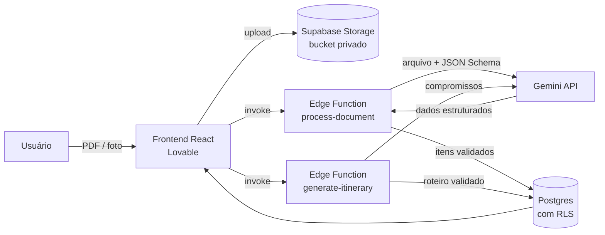

# TripMind — planejador de viagens com IA

Envie seus documentos de viagem (passagens, reservas de hotel, ingressos) em PDF ou foto. O TripMind **lê os documentos com IA**, extrai as informações importantes (voos, horários, hotel, códigos de reserva) e monta um **roteiro dia a dia** que respeita seus compromissos e sugere o que fazer nos horários livres.

🔗 **App publicado:** https://tripmindsite.lovable.app

## Como funciona



1. **Upload:** o arquivo vai para um bucket privado, na pasta do próprio usuário (`{user_id}/{trip_id}/...`).
2. **Extração (OCR + IA):** a Edge Function `process-document` envia o arquivo ao Gemini com um **JSON Schema**, que obriga a resposta a vir num formato previsível. O código valida a resposta e grava os itens.
3. **Roteiro:** a Edge Function `generate-itinerary` envia os compromissos confirmados ao Gemini, que preenche os horários livres com sugestões. O código confere o resultado antes de salvar.

## Stack

| Camada | Tecnologia |
|---|---|
| Frontend | React, TanStack Start/Router, TanStack Query, Tailwind, shadcn/ui, gerado com **Lovable** e ajustado manualmente |
| Backend | **Supabase**: Postgres, Auth, Storage, Edge Functions (Deno/TypeScript) |
| IA | **Gemini API**: leitura de PDF e imagem com saída estruturada (JSON Schema) |
| Deploy | Lovable (frontend) + Supabase (backend) |

## Decisões técnicas

**Segurança no banco, não só na tela.** Todas as tabelas usam **Row Level Security**: cada usuário só lê e altera os próprios dados, mesmo que alguém chame a API diretamente. O Storage tem a mesma regra por pasta. O frontend não pode inserir roteiros nem mudar o status de documentos; só a Edge Function faz isso, com a service role.

**A chave da IA nunca chega ao navegador.** A `GEMINI_API_KEY` fica nos *secrets* do Supabase e só as Edge Functions têm acesso a ela.

**"A IA sugere, o código garante."** A resposta da IA nunca é gravada às cegas:
- o JSON Schema força o formato;
- datas inexistentes (como 30/02) são descartadas, textos têm tamanho máximo e tipos desconhecidos viram `other`;
- no roteiro, uma atividade só fica "Confirmada" se apontar para um item real; se a IA esquecer um voo ou hotel, o código coloca o compromisso de volta.

**Resiliência a falhas da IA.** Durante o desenvolvimento, o Gemini respondeu `503 — high demand`. Agora cada chamada:
- tenta de novo e, se o modelo principal continuar sobrecarregado, usa um **modelo reserva** mais leve;
- tem prazo máximo, para a função sempre terminar antes do limite de execução e gravar "Concluído" ou "Erro";
- registra qual modelo respondeu.

Documentos que ficaram parados podem ser reprocessados pelo botão "Tentar novamente".

**Processamento sem duplicidade.** Antes de processar, a função "reivindica" o documento com um `UPDATE` condicional (pendente/erro → processando). Dois cliques seguidos não geram processamento duplo.

**Proteção contra prompt injection.** Os prompts tratam o conteúdo do documento como dado e mandam ignorar instruções escritas nele. Também pedem para não copiar dados sensíveis (CPF, passaporte, cartão).

**Horários locais.** Os horários são guardados como aparecem no bilhete (`timestamp` sem fuso), porque um voo São Paulo → Lisboa mostra cada horário no fuso da sua cidade.

## Estrutura

```
src/routes/                        telas (login, viagens, detalhe com abas)
src/lib/trip.ts                    utilitários e chamada às Edge Functions
supabase/functions/
  process-document/index.ts        OCR + extração estruturada
  generate-itinerary/index.ts      geração e validação do roteiro
docs/database/
  01_schema.sql                    tabelas, índices, RLS e bucket
  02_processing_started_at.sql     ajuste para bancos já existentes
```

## Como rodar

1. Crie um projeto no Supabase e rode `docs/database/01_schema.sql` no SQL Editor.
2. Publique as duas funções de `supabase/functions/` e crie o secret `GEMINI_API_KEY` (chave gerada no [Google AI Studio](https://aistudio.google.com)). Opcionalmente, defina `GEMINI_MODEL` e `GEMINI_FALLBACK_MODEL`.
3. Frontend:
   ```sh
   npm install
   npm run dev
   ```

## Próximos passos

- Busca semântica (RAG) com `pgvector`: dicas de destino como base de conhecimento do roteiro.
- Servidor MCP para que agentes de IA consultem as viagens.
- Excluir documentos e limpar arquivos do Storage ao apagar uma viagem.
- Exportar o roteiro para PDF ou calendário.

## Sobre o desenvolvimento

Projeto desenvolvido com apoio de ferramentas de IA: **Lovable** para gerar o frontend e **Claude Code** no desenho do backend, na revisão de código e na depuração.
